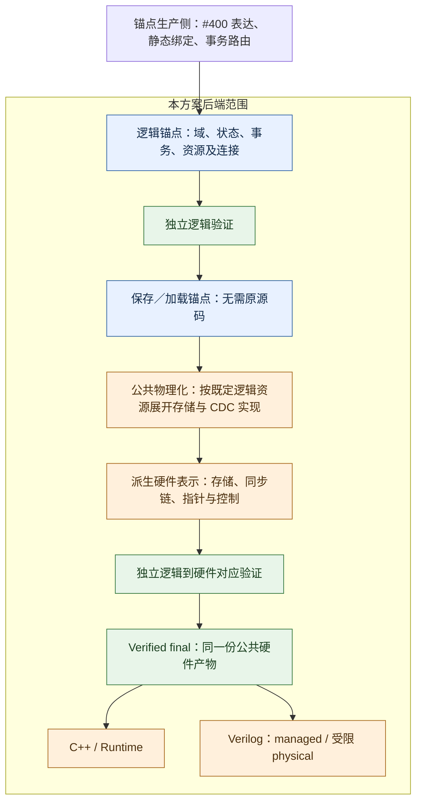
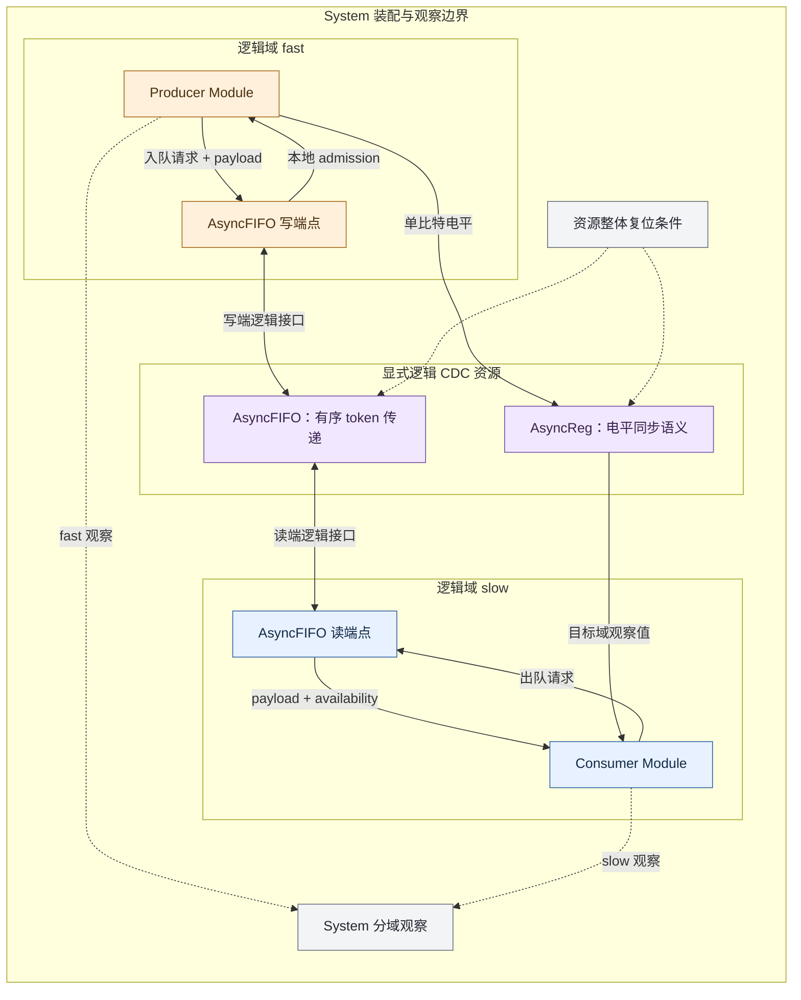
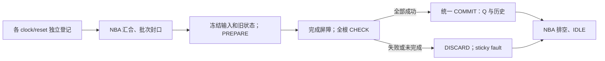

# 时钟域、状态复位与 CDC 后端方案

状态：完整后端实现与集成验证中；设计决策已定案，尚未完成全范围执行验收。
记录日期：2026-11-10。
增量说明更新：2026-11-12。
接口与行为示例补充：2026-11-12。
初稿源码检查基线：`e2ddd5a9fa9ac7522f9cfb460403b92519f23e0a`。
状态契约增量对照核对：`5f66e0a5bc8a1bd67e7f19e11a74da61cb8a1621`。

关联 [前端方案 #400](https://github.com/PTO-ISA/pyCircuit/issues/400)、
[#376 D](https://github.com/PTO-ISA/pyCircuit/issues/376) 和
[#319](https://github.com/PTO-ISA/pyCircuit/issues/319)。

本方案的后端边界从**逻辑锚点开始，包含锚点本身**，向下覆盖公共物理化、
final 验证、C++ Runtime 和 Verilog 导出。Python 语法、静态容器解析、
默认域选择及源级 Method 路由由锚点生产侧完成。

交付范围覆盖本文件全部后端要求。完整候选使用 routed contract 6、保存 schema 5；
GFIR 承载逻辑状态，主干 contract 4/5 保持既有语义；
逻辑 clock/reset SSA 与域属性共同描述逻辑事件，不承诺物理端口或同步器拓扑。
Python 作者接口及其默认参数捕获仍由 #400 的生产侧负责；后端直接使用手写 IR 验证。

## 变更类型与所属领域

Design proposal / RFC；IR、锚点持久化、存储与 CDC 物理化、运行时及代码生成。

## 问题与影响

前端方案 #400 提出 Module 时钟域配置、逐状态复位属性，以及显式 AsyncReg／AsyncFIFO。
后端需要定义这些能力在锚点中的逻辑契约，并在同一公共通路中实现两个目标。

**既有架构要求：锚点只包含完整、可独立验证的逻辑语义，不选择存储单元、CDC 电路拓扑或执行适配。**
时钟域、更新边沿和复位条件在锚点中描述何时允许逻辑状态转移；
它们不等于已经生成 clock/reset 物理端口或门级控制线网。

现有 [routed anchor](../architecture/routed-anchor.md) 和
[saved anchor](../architecture/saved-anchor.md) 是实现基线。
当前文档和实现中仍有显式存储原语等表示路径；这些表示与既有架构边界之间的差异，
应作为实现对齐与规范化工作记录，不能据此把“锚点只含逻辑语义”列为新增要求。
相关存量路径的处理范围和迁移方式需要明确，但逻辑与物理实现的边界不重新定义。
现有冻结契约和批准记录保持原样；表示调整不能隐式改变已有设计的行为。

## 本次新增什么

本文按增量提案阅读。下文使用四类标记：

- **新增契约**：为新增能力增加的语义；现有要求的实现尚不完整不构成新增理由。
- **实现扩展**：复用现有机制，对齐已有要求或补齐新增能力的处理。
- **沿用要求／机制**：保持的既有架构约束和行为，不计作本次新增。
- **已定案语义**：本轮实施采用的明确行为；实现和执行证据仍分别记录。

### 既有边界，保持不变

- **逻辑与物理实现边界**：锚点表达逻辑语义，DFF、同步链、Gray 指针和存储阵列由锚点以下生成。
- **域与采样事件边界**：实例、接口和状态有明确域及更新事件；普通连接必须遵守已有域约束。

这两项不是本次新增的锚点边界。域引用的表示具体化、检查补齐和存量原语规范化，
属于落实既有要求的工作。本方案不增加第二个公共锚点阶段。

### 新增能力与实现增量

| 主题 | 现有基础 | 本次增量 | 分类 |
| --- | --- | --- | --- |
| 域表示与检查 | 已有域/采样约束、clock/reset 连接和实例身份 | 将既有约束落实到本方案的域引用、接口及新增 CDC 端点表示 | 实现对齐／扩展，不是新增边界 |
| 状态与复位 | `state(clock, reset, initial)`、Q/candidate/intent；当前物理化采用上升沿、同步高有效复位 | 显式边沿、sync/async/none、高/低有效、独立 reset_value 与 init | 新增契约及实现扩展 |
| 未指定初值 | 现有逻辑 state 要求 initial | 显式 unspecified，存储位全 X，payload 仍可用 | 已定案语义／实现扩展 |
| 混合复位事务 | 保留现有事务激活、接纳和原子提交 | 静态传递效果端点的 reset 集合统一屏蔽正常事务 | 已定案语义／实现扩展 |
| CDC 资源 | 普通状态和 Queue 已有所有权及接纳合同 | 新增 AsyncReg/AsyncFIFO 逻辑资源、域端点合同及公共物理化 | 新增契约及实现扩展 |
| 验证与保存 | 独立锚点验证、保存/加载及逻辑到硬件对应检查已经存在 | 为域表示、新增状态属性和 CDC 扩展检查及版本化保存内容 | 实现扩展 |
| 双目标执行 | 共用 verified final、Work 旧状态快照、全根检查后提交已经存在 | 补齐新边沿、异步复位和 CDC 内部状态的计算与回滚 | 实现扩展 |
| Physical | 当前有受限单域导出 | 内部 NBA 批次协调，明确输入稳定／批次封口合同，独立验收 | 实现扩展 |

类型、实例所有权、每状态一个 update、无写入保持、失败零提交以及
两目标共用 final 都是沿用机制。本文提到它们，是为了规定新增能力应保留的行为，
不是声称本次才建立这些机制，也不新增原本尚未支持的类型路径。

## 示例阅读约定

下文用具体例子说明域绑定、新旧状态接口、复位行为和 CDC 资源。
MLIR 风格代码是**拟议接口示意**，不是当前 parser 已接受的完整语法，也不是 Python
`ac.state(...)`。为突出增量，省略完整 Module 签名、来源／所有权元数据及无关的逻辑表达式。
例子中的局部域 `D` 必须通过实际实例绑定解析到确定的逻辑时钟源。

`%zero`、`%five` 分别表示已定义且类型匹配的静态常量 0、5；
`%candidate`、`%intent` 表示已路由的正常候选值和写意图。
所有状态例子都显式提供 init，不提前决定省略 init 的语义。
CDC 资源记录使用说明性文本，不额外引入已经实现的 op 或资源类型拼写。

## 后端边界与总体流程

图中锚点保存“设计做什么”；具体硬件结构和运行机制从公共物理化开始产生。
展开结果与 final 都属于锚点以下的派生表示，不是逻辑锚点的一部分。



## 期望行为

### 1. 锚点包含完整、可独立验证的逻辑语义

**沿用要求／机制**：仅逻辑语义的锚点边界、明确域和采样事件、完整实例闭包、
独立验证、所有权、候选值及结果可用性都是既有要求。
**本次增量**：在这一边界内补充逐状态复位属性和显式 CDC 资源合同，并落实到表示与验证。
下表列出交接内容的全集，不作为新增要求清单。

| 内容 | 锚点必须确定的逻辑信息 |
| --- | --- |
| 层次与所有权 | Module 实例、逻辑状态和资源的身份及连接 |
| 域与更新事件 | 局部域引用、实际实例绑定、逻辑时钟源身份及有效边沿 |
| 状态 | 类型、初始化语义、复位条件、复位方式、极性和复位值 |
| 事务 | 已规范化的候选值、写意图、激活条件、资源接纳及结果可用性 |
| CDC | 显式组件的逻辑行为、容量、两侧域、端点角色及整体复位语义 |
| 检查 | 检查条件、采样与复位屏蔽、来源及逻辑提交对象 |

锚点不能残留待执行的 Python 配置、待选择的默认域、未路由 Method 调用或
待决定的跨域协议。局部域参数可保留在共享定义中，但选定根的每个实际实例
必须能够解析到确定的逻辑时钟源。相同名称、频率或激励波形不建立域等价关系。

逻辑条件可以是 typed SSA 表达式；逻辑连接和事务规范化不意味着已经选择门电路。
锚点不要求 DFF/DFFE 实例、同步器级间连接、Gray 指针、payload bank／mux、
物理端口编号、PREPARE／COMMIT 控制线或 Verilog NBA 调度。

锚点合法性与后端实现范围分别判断。一个正容量 FIFO 可以具有完整逻辑语义，
而某一物理化实现只支持其中部分容量；后者应在物理化时报告不支持，
不能反向修改锚点容量或把实现限制变成逻辑合法性条件。

### 2. 逻辑域、接口与跨域连接

**沿用要求**：域归属、更新事件以及普通连接的同域约束保持不变。
**实现扩展**：把这些要求落实到域引用、实例绑定和逐接口检查，并覆盖新增 Async 资源的端点。
本节不新增域的概念、逻辑/物理边界或普通 payload 类型；
新增资源的具体逻辑合同见第 5 节。

域配置沿用 #400 的 op 属性方向，不修改普通 payload 类型：

- 定义内保留局部域参数和默认域，实例保留绑定关系。
- 根绑定到逻辑时钟来源；clock 物理端口与线网由后续公共物理化产生。
- 每条数据、请求、availability 和提交关系都必须有可推导的逻辑域归属。
- reset 是专门的逻辑控制引用，不从名字推断极性或协议。
- 更新边沿独立于时钟源身份；同源 posedge／negedge 不属于同一次普通事务。

组合表达式传播实际数据和控制依赖。真正无域依赖的常量可以用于多个域。
普通 Module 包装不能改变域归属，只有显式 CDC 资源可以连接不同域。

#### 示例：相同局部域名绑定到不同实际域

两个可复用 Module 的定义都可使用局部域参数 `D`：

```mlir
// Producer 和 Consumer 各自定义中的属性，局部名字互不建立连接。
ac.domain_params = ["D"]
ac.default_domain = "D"

// System 中 Producer 实例的属性。
ac.domain_bindings = {D = "fast"}

// System 中 Consumer 实例的属性。
ac.domain_bindings = {D = "slow"}
```

锚点根还需提供 fast、slow 的逻辑时钟源绑定；它们表示确定的来源身份，
不因两个实例都写了 `D` 或频率相同而合并。
若 fast、slow 解析为不同来源，下面的普通连接应被拒绝：

```text
Producer@fast.result --普通连接--> Consumer@slow.input
```

作者／上游必须先明确电平同步还是 token 通信，再生成相应逻辑 CDC 资源。
后端不会遇到这条连线时自动猜测资源种类。

下图画的是逻辑接口，不展示同步级、指针或存储电路。
AsyncFIFO 的两端分别属于各自域，其本地域 admission 由编译器维护。



System 分域观察是验证边界，不产生 DUT 跨域数据通路。
普通父 Module 的输入／输出仍遵守其自身域规则；不能把 slow 输出直接穿过 fast
父 Module 返回。#400 早先 Top 示例与其后补充的 I/O 规则需要对齐，
后端不为该示例添加隐式豁免。

### 3. 逻辑状态与复位契约

**沿用机制**：现有状态及更新配对不重做。
现有锚点声明为 `gfir.state(clock, reset, initial) -> T`，保留 committed Q、
candidate 和 intent：

```text
state -> committed Q
state.update(Q, candidate, intent)
```

**新增契约**是负沿更新、异步／无复位、低有效复位，以及独立 init/reset_value 等能力。
下表同时列出配套表示调整，后者不计为新增语义。
“现有行为”指上述逻辑 state 及其当前存储物理化，
不把所有结构化原语用例一概归为同一能力范围。

| 属性 | 现有行为 | 提案增量 |
| --- | --- | --- |
| 更新边沿 | 当前存储物理化采用上升沿，无独立 edge 策略 | 显式 `posedge/negedge`，验证事务与状态的边沿一致性 |
| 复位方式 | 同步复位 | 显式 `sync/async/none`，允许无边沿的异步复位转移 |
| 复位极性 | 高有效 | 显式 `high/low`，逻辑解释与目标实现一致 |
| 复位控制 | 已有真实 reset 连接 | 保留逻辑连接，增加显式无复位及逐状态策略 |
| 复位值 | 使用同一个 initial 作为复位目标 | 增加独立 `reset_value`，允许不同于 init |
| 初始化 | 逻辑 state 要求 initial | 独立 init；unspecified 为 typed packed 全 X |
| 时钟归属 | 已有 clock 连接和域/事件约束 | 对齐既有逻辑边界，以逻辑域/事件引用具体化表示；属于表示调整 |

例如，新契约拟允许 `init=5, reset_value=0`，分别描述初始化和复位后的值；
现有逻辑 state 只有一个 initial，不能独立表达这两个值。
上述新增能力及表示调整均是提案，不代表当前已经支持。

**沿用机制**：reset 使用真实逻辑引用或表达式；初始化值及复位值接受类型和静态检查。
每个状态恰好对应一个 update，无正常写入时保持；复位独立于正常事务激活，
guard false 不能阻止复位。已有 payload 类型、所有权和实例身份保持。

**已定案语义**：未指定 init 表示逻辑类型保持不变的全 X 存储位，known=0、z=0，
payload 保持可用；Host Reset 恢复同一语义。不得填入 reset_value 或零，
也不据此证明 Enum 成员或 Integer 取值合法。综合不承诺实际上电值。
无复位状态没有自身复位转移，但其正常更新仍受同一事务其他效果端点的 reset 屏蔽。

#### 示例一：旧接口与保持原行为的新接口

现有接口在概念上为：

```text
gfir.state(clock, reset, initial) -> T
gfir.state.update(Q, candidate, intent)
```

clock、reset 和状态的域/事件归属原本就存在，不是本提案新增的概念或边界。
拟议新版本用 `domain` 属性引用逻辑更新事件源，替代旧 clock 操作数；
reset 继续作为逻辑 SSA 控制引用。以下配置保持上升沿、同步高有效、初始值和复位值均为 0：

```mlir
%q = gfir.state "count"
    init(%zero)
    reset(%rst)
    reset_value(%zero)
    {
        domain = "D",
        edge = "posedge",
        reset_kind = "sync",
        reset_polarity = "high"
    } : !ac.bits<8>

gfir.state.update(%q, %candidate, %intent)
```

`state.update` 的配对关系和 Q/candidate/intent 机制不变。
旧 clock 到逻辑域引用的调整属于新版本表示变化，用于对齐既有逻辑边界；
不能仅加一个属性就宣称已完成迁移。

#### 示例二：初始化为 5，低有效异步复位到 0

```mlir
%q = gfir.state "count"
    init(%five)
    reset(%rst_n)
    reset_value(%zero)
    {
        domain = "D",
        edge = "posedge",
        reset_kind = "async",
        reset_polarity = "low"
    } : !ac.bits<8>

gfir.state.update(%q, %candidate, %intent)
```

- 初始化后的逻辑值为 5。
- `rst_n` 已知为 0 时，状态复位到 0，不等待 D 域上升沿，也不要求正常事务激活。
- `rst_n` 已知为 1 时，在 D 域上升沿按正常候选和写意图更新；其他时候保持。
- reset 值为 X/Z 时仍执行根 `strict|if_one` 合同，不由本例放宽。

这里独立的 init/reset_value、async 和 low 都是新增表达能力。

#### 示例三：无复位状态与更新边沿

```mlir
%q = gfir.state "saved"
    init(%five)
    {
        domain = "D",
        edge = "posedge",
        reset_kind = "none"
    } : !ac.bits<8>

gfir.state.update(%q, %candidate, %intent)
```

无复位状态不带 `reset`、`reset_value` 或 `reset_polarity`。
初始化仍为 5；之后只在正常事务成功激活且匹配更新边沿时写入，其他情况保持。
若将本例的 `edge` 改为 `"negedge"`，正常更新改为发生在 D 域下降沿。
同域上升沿状态和下降沿状态不能据此组成一次普通原子事务。

拟议接口的字段归属为：

| 字段 | 表示与约束 |
| --- | --- |
| domain | 属性中的局部逻辑域引用，必须完成实际实例绑定 |
| edge、reset_kind | 完整的枚举属性，在锚点中不留给 emission 猜默认值 |
| reset_polarity | 有复位状态的枚举属性；none 时省略 |
| reset | 有复位状态的单比特逻辑 SSA 操作数；none 时省略 |
| reset_value | 有复位状态的类型匹配、静态闭合 SSA 值；none 时省略 |
| init | explicit 时为类型匹配、静态闭合 SSA 值；unspecified 时没有该操作数 |

### 4. 事务与复位的关系

**已定案语义**：本节新增的是“不同复位端点参与同一正常事务”的屏蔽规则，
不是重新建立事务原子性。锚点必须明确以下关系，后端不能在 emission 时重新选择解释：

- 一次正常事务的全部传递效果共享实际逻辑时钟源和更新边沿。
- 将静态传递效果端点的复位条件统一用于屏蔽正常事务，包括条件分支中的效果。
- 任一相关复位有效，整次正常事务不激活。
- 各状态仍按自身 sync／async 条件独立复位，其他状态保持。
- 复位不等于正常事务成功，不产生普通结果 availability。

相关效果包括状态写入、Queue／AsyncFIFO 操作和已经路由的 Method 传递效果。
普通 committed-state 读取不自动增加生产者复位条件；只读资源操作仍遵守自身
admission 和 availability。无效果 Rule、检查和 observation 保留明确的采样／复位合同。

锚点的精确 reset 集合定义此逻辑屏蔽，不要求生产侧预先生成物理控制门。
公共 lowering 在 CDC／存储展开前生成整事务 mask；独立对应检查重建 mask，
并检查其余图、SSA、所有候选意图和结果 availability 的对应关系。
极性归一后按 known-active 判定 reset；strict 的 reset-known 义务独立执行，
不能用另一有效 reset 掩盖未知 reset。if_one 仅将归一后的 known-one 视为有效。

#### 示例：一个状态复位，另一个状态保持

假设 A 是高有效异步复位状态，复位值为 0；B 是无复位状态。
两者属于相同 D 域、相同上升沿，由同一个正常事务执行 `A+1, B+1`。
在 A=5、B=9 时应有以下结果：

| 事件 | 正常事务 | 事件提交后的 A、B |
| --- | --- | --- |
| 两个边沿之间，A 的复位条件变为有效 | 不激活 | A=0，B=9 |
| A 仍在复位，D 域到达上升沿 | 整体被屏蔽 | A=0，B=9 |
| A 的复位撤销后，下一个有效上升沿且其他接纳/检查通过 | 同时执行两个正常写入 | A=1，B=10 |

B 自身无复位，所以复位事件不把它改成初值；但在这个联合事务中，
A 复位期间也不会只让 B 的正常写入先成功。
本表表示成功事件后的逻辑状态，不改变 Runtime 的 Work 旧状态观察合同。

### 5. 锚点中的逻辑 CDC 资源

**新增契约**：AsyncReg/AsyncFIFO 的逻辑资源身份、跨域端点和行为合同。
按 #400 当前方案，用户/上游必须明确采用哪个逻辑资源，锚点中资源种类已经确定。
IR 可以推导哪里跨域并检查连接；后端不根据普通连线猜测应使用 AsyncReg 还是 AsyncFIFO。

锚点保存 CDC 的可观察行为和连接约束，不保存所选电路拓扑。
逻辑资源必须具有版本化契约、唯一身份、确定的端点域和完整接纳／提交关系，
不能使用普通 extern 或任意 `cdc=true` 属性代替。

| 资源 | 锚点中的逻辑合同 |
| --- | --- |
| AsyncReg | 单比特电平从源域向一个目标域同步；非消费观察；允许漏掉短暂变化；不保证每次跳变或精确固定拍数可见；整体复位归零 |
| AsyncFIFO | 正容量、单写域／单读域；本地成功操作才产生或消费 token；有序、不丢失、不重复，整体复位除外；跨域 availability 可延迟 |

AsyncFIFO 不隐式广播，不将线上持续有值解释为反复入队，也不形成跨域原子事务。
整体复位清空资源；恢复期间端点不可传输。
复位完成前保持不可用，以及在两域持续运行且无故障时最终恢复，属于逻辑合同；
具体完成协议和延迟由所选物理化实现落实，不能无故永久阻塞。

AsyncReg 的级数、FIFO 的 Gray 编码、存储结构和复位释放电路属于下述物理化方案。
前端方案 #400 对“两级”的表述在这里落实为首选实现，不把内部级间连接加入逻辑锚点，
也不据此承诺精确两拍的外部行为。

#### 示例一：跨域观察一个持续电平

```text
resource mode_sync: AsyncReg<u1> {
    source_domain = fast
    target_domain = slow
    input = Producer.mode
    output = Consumer.mode
    whole_reset = common_reset
}
```

这里资源种类已经显式确定为 AsyncReg，Producer.mode 和 Consumer.mode 表示各自
实例的真实逻辑端点。fast 侧把电平从 0 改为 1 并持续保持，slow 侧允许延迟观察到 1。
如果源端短暂 `0 -> 1 -> 0`，目标端可能一直只看到 0；本资源不承诺传递每个变化事件。

锚点只记录这个行为和两端归属，不包含 stage1/stage2 连接。

#### 示例二：跨域传递每一条成功入队的数据

```text
resource requests: AsyncFIFO<u8, depth=4> {
    write_endpoint = Producer.tx @ fast
    read_endpoint = Consumer.rx @ slow
    whole_reset = common_reset
}
```

设 A、B 分别代表两个不同的 u8 值 17、34。复位完成后的操作可以是：

```text
fast 写端成功入队 A，再成功入队 B
    -> FIFO 逻辑上保存两个有序 token
    -> slow 读端经允许的可用性延迟获知有数据
    -> slow 第一次成功出队得到 A
    -> slow 第二次成功出队得到 B
```

fast 不必等待 slow 在同一拍完成接收；接纳失败的请求也不能被当成已经入队。
数据线持续为 A 不代表每个边沿自动入队 A，必须有明确的成功入队操作。
本例不承诺固定跨域延迟，且不在锚点中出现 Gray 指针、同步链或存储阵列。

## 共同后端设计

### 1. 独立锚点验证

**实现扩展**：沿用现有独立 routed verifier，为新域、状态属性和 CDC 资源增加检查。
无源码验证闭包、类型、所有权和更新配对等机制不是本次新增。
扩展后在没有 Python、原 source units 和源级分析对象时检查：

- 逻辑域绑定、接口域归属和完整实例闭包。
- 状态／update 配对、类型和独立实例所有权。
- 更新事件、事务效果、复位屏蔽及结果 availability。
- CDC 资源的逻辑端点、操作、容量和整体复位关系。
- admission、提交对象、组合依赖环与逻辑时序切断。
- 完整检查及观察清单。

属性是待核验描述，不是自动通过的证明。
锚点验证不依赖某一同步器或 FIFO 的物理实现，
也不以根绝对路径、内存指针或缓存结果代替现有定义相对引用和实例身份。

### 2. 存储公共物理化

**实现扩展**：现有逻辑状态到 typed DFF/DFFE 的物理化继续使用；
新增边沿、复位方式/极性以及独立 init/reset_value 的实现及对应检查。

将逻辑状态降为 typed DFF／DFFE 等受验证的公共存储实现，支持正／负边沿、
同步／异步／无复位、高／低有效及独立 init／reset_value。
clock/reset 物理端口、使能、数据连接和类型布局在此生成。

状态转移必须保持逻辑合同：异步复位可在没有更新边沿时生效；
同步复位仅在对应更新事件生效；其余时候按正常写入或保持处理。
根 `strict|if_one` 复位解释在适配极性后统一使用，两个目标不能各自覆盖。

现有原语契约和公共状态转移内核需要扩展，不能只修改 Verilog 敏感列表。

### 3. CDC 公共物理化

**新增实现**：为锚点中已经明确的 AsyncReg/AsyncFIFO 生成公共派生硬件表示。
“实现选择”只涉及同一逻辑资源的电路实现，不涉及决定电平同步还是队列通信。
首版拟固定采用以下展开：

| 逻辑资源 | 首选物理实现 |
| --- | --- |
| AsyncReg | 目标域两级状态，同一目标域边沿推进，普通消费者只访问第二级 |
| AsyncFIFO 控制 | 本地 binary／registered Gray 指针、wrap bit、对端指针两级同步、本地 full／empty |
| AsyncFIFO 数据 | typed 寄存器 bank 和读选择逻辑 |
| AsyncFIFO 复位恢复 | 共同异步断言、各域两级同步释放、交换 released 信息 |

#### 示例：将已确定的 AsyncReg 展开为同步链

对上文 `mode_sync`，首选公共实现可以展开成：

```text
仅在 slow 域有效边沿准备：
    stage1_next = Producer.mode
    stage2_next = old(stage1)

Consumer.mode = committed(stage2)
```

两个存储阶段在同一 slow 边沿都读取旧状态，不能让 stage2 直接读本次 stage1_next。
共同 reset 使两级归零，普通消费者不能绕过第二级。
这段结构存在于派生硬件表示，C++ 和 Verilog 共用；原逻辑锚点保持不变。

#### 示例：同一个 FIFO 的读写独立提交

对上文 `requests`，派生实现中的本地域操作为：

```text
fast 写端事务成功：写一个完整 token，同时推进本地写指针
slow 读端事务成功：消费旧 head，同时推进本地读指针
本地域内部事件：推进远端指针同步链和复位恢复状态
```

若同 epoch 两端都成功，各自根据旧本地视图操作，不让读端绕过同步信息读到
本次刚写入的新 token。C++ 不能把同一资源替换成即时共享队列来消除这种延迟。

FIFO 首个实现支持二次幂容量且至少为 2。这是物理化支持范围：
对其他逻辑合法容量报告该实现暂不支持，不自动向上取整，也不改变锚点合同。
后续 RAM 或其他容量实现应有明确存储／编码契约和对应验证。

本地 full／empty 只使用本地状态及已同步的远端信息。
不使用跨域同拍腾位旁路或 empty flow-through。
本域成功入队时，共同提交 slot 写入和写指针；成功出队时推进读指针。
同步链自主按本域成功边沿推进，不依赖用户事务激活。

复位恢复具体采用：

1. 共同 reset 断言，清零指针、同步链和释放状态，并关闭传输。
2. 各侧在自己的两级释放链完成后独立产生 local released。
3. local released 通过两级同步送往对端。
4. 本地及同步后的对端 released 均有效，才允许本端传输。

local released 不等待对端 ready 才产生。任一侧停钟时相关恢复无法完成，传输保持禁止。
再次复位清除旧恢复记录；payload slots 不必清零。
资源两端必须连接同一整体复位，不能隐式 OR 两个独立复位源。

物理化后保留可验证的组件边界和同步器身份，防止优化合并同步级、暴露第一级或引入旁路。
这份派生实现可记录同步级数和编码选择；原逻辑锚点保持不变。

### 4. 独立验证逻辑到硬件的对应关系

**实现扩展**：沿用已有独立 refinement 对应检查，新增状态策略及 CDC 展开关系的检查。

每次转换生成独立候选，再检查并发布。逻辑锚点验证与实现对应检查是两项责任。

对应检查至少覆盖：

- 每个逻辑状态对应正确存储，类型、实例身份及初始化／复位行为一致。
- 候选值、写意图和正常事务激活条件不变。
- AsyncReg 实现满足电平同步合同且无可观察旁路。
- FIFO 指针、同步、存储及恢复结构符合所选实现合同和逻辑资源行为。
- 数据操作与本域事务共同提交；内部自主状态仍受全局失败屏障约束。
- 检查、availability 和失败零提交义务完整保留。
- 无关内容保持原有语义。

不能仅凭 final 自身合法，就证明它实现了输入锚点。
Final 不得残留未实现的逻辑状态、逻辑 CDC 节点或未绑定域。
允许的优化必须保持这些对应关系。

### 5. 保存锚点与版本

**实现扩展**：保存/加载、自包含内容、配置身份和失败输出保护均已有；
本次扩展保存的语义字段及相应版本，不新建一套锚点发布机制。

升级 routed contract 和保存格式的相应 schema；新含义不能静默放进旧 contract。
继续复用 `anchor.json`、`graph.ac`、definition spec/body 和保留的 source interface 清单。

域、逻辑状态和 CDC 合同进入相应 spec/body、配置和内容身份。
逻辑锚点的语义配置不保存 DFF 型号、同步器拓扑或目标仿真 phase。
物理实现选择属于后端配置／派生产物，并在执行或生成证据中绑定原锚点身份；
它不能覆盖逻辑容量、复位或事务行为。

重新加载不需要 Python 或原 source units，不重新路由事务，
不允许覆盖逻辑域绑定、状态策略或根 reset interpretation。
加载后独立验证图和配置。失败保留输入锚点及已发布输出。

#### 示例：从同一份保存锚点生成两个目标

以下沿用已有公开命令入口；新契约内容尚待实现，命令不构成其当前支持或执行证据。
`saved-anchor` 代表已经生成、保存且无需原源码的锚点目录：

```bash
pycircuit link --from-anchor saved-anchor --verify-only
pycircuit link --from-anchor saved-anchor --target final -o design.ac
pycircuit emit design.ac --target cpp -o cpp
pycircuit emit design.ac --target verilog -o rtl
```

两次 emit 读取相同的 `design.ac`。后端不在 cpp 路径重新决定 CDC 类型，
也不在 verilog 路径重新解释 init/reset_value。

### 6. 两个目标执行同一公共硬件

**沿用机制**：两个 emitter 共用 final、旧状态快照、全根检查后提交及失败丢弃。
**实现扩展**：支持新边沿、异步复位，以及同步链、FIFO 和恢复状态的转移及回滚。

C++ 与 Verilog emitter 都消费同一份 verified final。
C++ 不得以即时共享 occupancy 替代异步 FIFO，也不得透传 AsyncReg。

Runtime 与 managed RTL 保持共同执行合同：

- 每个 epoch 冻结全部输入，所有域读取同一 committed snapshot。
- 同 epoch 边沿不能看到对端尚未提交的值。
- 异步复位可以在没有 clock edge 的 epoch 产生候选。
- 全根检查通过后统一提交。
- 失败丢弃数据、指针、同步链、恢复状态、采样历史和 observations。

普通 backpressure 或 guard false 仅阻止对应操作，不等于全根故障。
成功 Work 的观察仍为旧状态快照；不暗加硬件周期。
数字同步器模型不宣称模拟模拟电路亚稳态，也不提供硬件精确两拍可见的保证。

PREPARE、COMMIT、Xfer 和 NBA 是目标执行机制，不写回逻辑锚点。

### 7. Physical 导出单独验收

**实现扩展**：contract 6 使用内部事件批次协调；旧版本保持既有单域路径。
公开接口仍为普通 clock/reset/data，不要求作者驱动 PREPARE／COMMIT。

支持的激励合同为：数据及功能控制先稳定，同一批 clock/reset 变化在同一调度区提交；
每个根控制输入每批最多改变一次，输入保持到所有 delta 轮次排空，随后在只读／时隙末观察。
启动封口时所有根时钟必须为 known 0，与 managed Host Reset 的 false history 一致；
首批没有正常边沿，异步复位及适用检查照常执行。初始 1/X/Z 在任何提交前触发全根
DISCARD 和 sticky fault，包括已经准备的异步复位候选。任意 `#0`／后续 NBA
交错重驱动不属于这一批次合同。

每个事件来源使用独立登记槽。根协调器封口后冻结输入与旧 Q，分轮准备、检查和提交；
任何 leaf／检查未完成或失败，都丢弃本批数据与历史，并保持 sticky fault。
Q 改变后的组合重算不会重新打开同一批次。全过程没有功能性门控时钟或 `#delay`。



Physical 要求 clock 仅由根控制输入转发；reset 可为根控制输入的 total、前馈表达式，
不接受状态、CDC 状态或事务结果反馈引起的异步事件级联。closed System 的生成式
观察使用 managed 目标；physical 用普通 Module 和外部测试观察边界。
综合从相同 final 生成标准 posedge／negedge／async sensitivity，不承诺模拟故障回滚电路。
managed、physical 功能与综合展开分别验收，不能关闭诊断后宣称 physical 通过。

## 实施分片

| 分片 | 后端交付 |
| --- | --- |
| B1 | 沿用逻辑锚点及域边界，增加状态复位与 CDC 合同，扩展表示和独立 verifier |
| B2 | 新版本保存格式、配置与内容身份、独立 reload |
| B3 | 存储与 CDC 公共物理化 |
| B4 | 锚点到派生硬件及 final 的独立对应检查、优化约束 |
| B5 | C++、managed RTL、System 执行、端口描述及受限 physical |

System 与端口描述只承载从锚点导出的逻辑观察／驱动和目标接口；
源码语法或上游静态参数解析不划入这些后端任务。

## 用例与验收

采用少量完整案例验证核心行为：

1. 直接构造逻辑锚点，在新进程中独立解析、验证、保存和加载。
2. 移除源码及 source units 后，从锚点物理化并发射两个目标。
3. init 与 reset_value 不同、无复位状态、沿间异步复位及选择性保持。
4. AsyncReg 电平同步行为，以及所选实现的两级关系和无旁路。
5. FIFO 顺序、wrap、满空、整体复位、停钟与恢复。
6. 同 epoch 双域边沿读取旧快照；后置真实故障导致全部候选零提交。
7. 同一 final 的 native workers 1／2 与四态 managed RTL 对应行为一致。
8. 逻辑合法但实现暂不支持的容量，在物理化时明确失败且不修改原锚点和旧输出。

前端端到端测试验证双方交接，不能替代后端直接锚点覆盖。
Physical 功能与综合展开分别收集证据。
构建和编译器执行遵循现有 dev 验证流程；长矩阵留在已有 nightly 入口。

## 实施定案与精确 IR 接口

完整候选采用 routed contract 6／schema 5，保留主干 4／3、5／4 的读取语义；旧的 2／1、3／2 继续拒绝。
实例域绑定在锚点中必须完整；默认继承由锚点生产侧规范化，不在 reload 时重新选择。
schema 5 的配置增加实际实例路径、formal、根 clock input 的规范绑定列表，加载时独立重推。

下面是实际 generic IR 的操作片段；`%clk`、`%rst_n` 和常量须由所属 Module 定义：

```mlir
%q = "gfir.state"(%clk, %rst_n, %five, %zero) {
  instance_name = "count", occurrence = #count_occ,
  domain = "D", edge = "negedge", reset_kind = "async",
  reset_polarity = "low", init_kind = "explicit",
  operandSegmentSizes = array<i32: 1, 1, 1, 1>
} : (!b1, !b1, !b8, !b8) -> !b8
"gfir.state.update"(%q, %candidate, %intent) : (!b8, !b8, !b1) -> ()
```

操作数按 clock、可选 reset、可选 init、可选 reset_value 排列。
`reset_kind="none"` 省略 reset／reset_value／polarity；`init_kind="unspecified"`
省略 init。因此无复位且无初值的分段为 `array<i32: 1, 0, 0, 0>`，只有 clock 操作数。
属性中的逻辑域必须和 clock SSA 解析出的实际实例来源一致。

```mlir
%level = "ac.async_reg"(%src_clk, %dst_clk, %reset, %input) {
  instance_name = "status", occurrence = #status_occ,
  source_domain = "W", target_domain = "R", target_edge = "posedge",
  reset_polarity = "high", resource_contract = 1 : i64
} : (!b1, !b1, !b1, !b1) -> !b1

%head, %push_available, %pop_available =
  "ac.async_fifo"(%src_clk, %dst_clk, %reset) {
    instance_name = "requests", occurrence = #queue_occ,
    write_domain = "W", read_domain = "R",
    write_edge = "posedge", read_edge = "negedge",
    reset_polarity = "high", depth = 4 : i64, resource_contract = 1 : i64
  } : (!b1, !b1, !b1) -> (!payload, !b1, !b1)
"ac.async_fifo.update"(%head, %payload, %push_fire, %pop_fire)
  : (!payload, !payload, !b1, !b1) -> ()
```

push／pop 分别绑定经认证的本地域事务和 admission；以上配对不建立跨域原子事务。
AsyncReg 公共实现包含两级数据同步和独立的目标域两级释放，释放前数据级保持零，
不等待源时钟。FIFO 使用两侧本地释放与对端释放同步，不共享跨域 occupancy。
首个 FIFO 实现接受 2 的幂且至少 2 的容量；其他正容量保持逻辑合法并在物理化时拒绝。
final 保留自足的 `ac.cdc.refinement` 见证；重新加载 final 也必须重建并核对完整电路及端点，
不能凭 CDC 标签跳过域检查。通用 `ac.value.zero` 仅表示存储位全零，不证明 nominal 值合法。

## 候选与证据

本文件记录用户指定的逻辑锚点边界、已定案的后端合同和实现接口；执行验收另行记录。
2026-11-10 的讨论与源码检查记录在忽略的 `docs/gates/logs/` 下；
它们不是本文件、测试或干净 checkout 的依赖。

事务复位、未指定初值、CDC 恢复、版本与有限 physical 批次合同已完成独立设计审查。
逻辑锚点及域边界仍是沿用要求。当前实施和独立测试继续覆盖全部后端范围，
任何单项通过都不能代替全部验收；记录按精确候选归档在忽略的 gate evidence 中。
